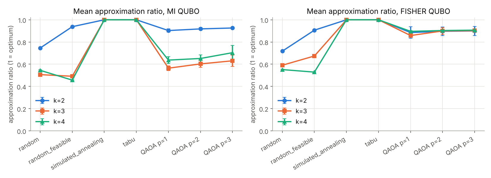
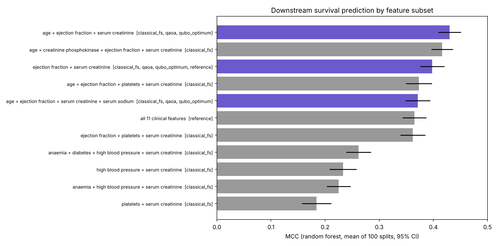
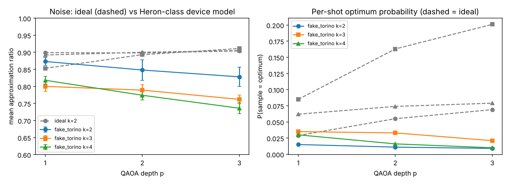
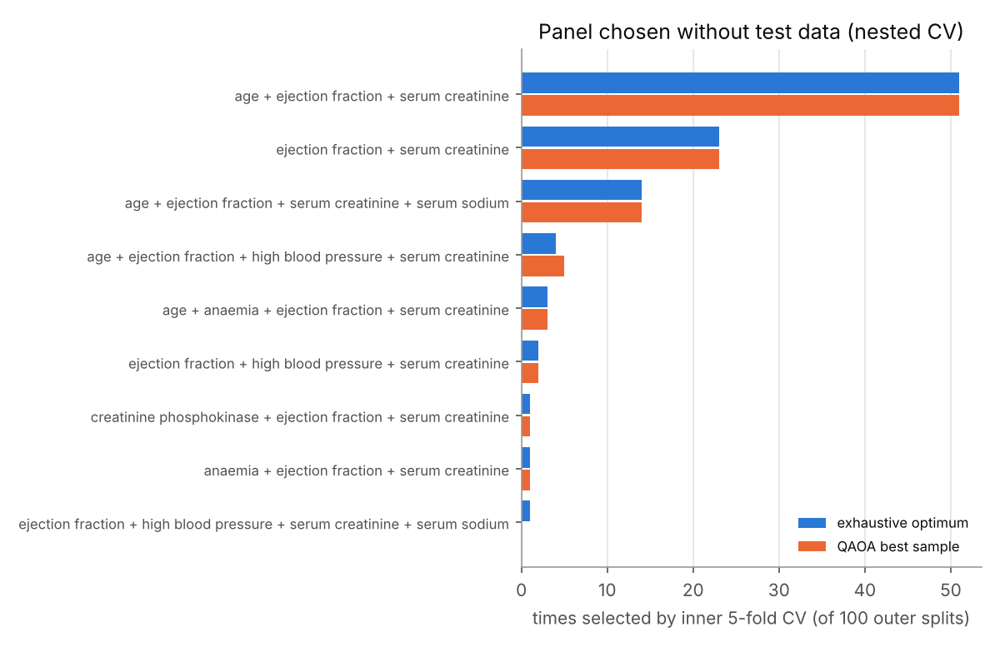
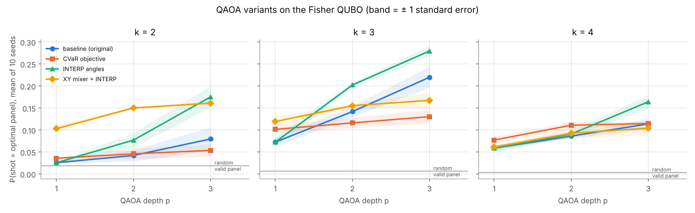
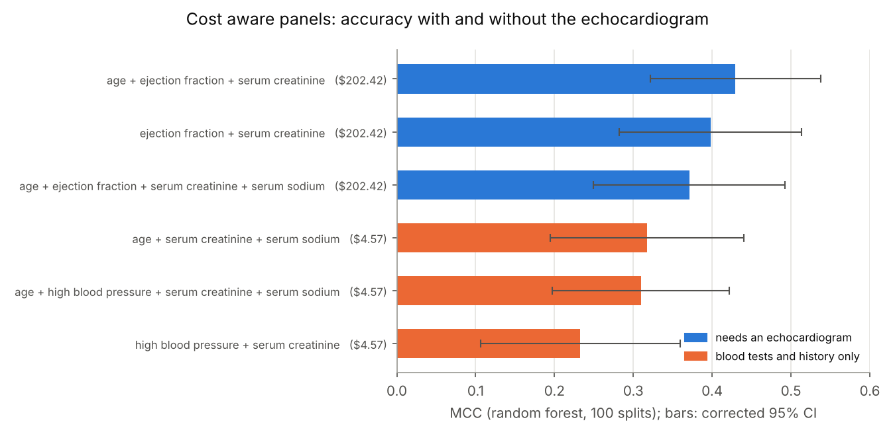

# Quantum feature selection for heart failure survival prediction

**KU QCI Qiskit Fall Fest 2026, Quantum Machine Learning for Healthcare track**

**▶ Live interactive demo:** https://qareenahqureshi-commits.github.io/qff-qml-heart-failure-qaoa/ (3D digital twin patient, live QAOA qubit register, circuit diagram and the landscape of all 165 panels; source: [`docs/index.html`](docs/index.html)).

## Abstract

Which few routine measurements best predict death in heart failure? We turned that question into a QUBO and solved it with QAOA in Qiskit (COBYLA, 2000 shots, 10 seeds).

The data is the UCI Heart Failure Clinical Records set: 299 patients and 11 features, so 11 qubits. The score rewards measurements that separate deaths from survivors and penalises overlap between them (Mücke et al. 2023, plus a Fisher/covariance variant). QAOA found the best three-measurement panel, age, ejection fraction and serum creatinine, in every seed. We checked that against brute force over all 165 panels.

A random forest on those three numbers scores MCC 0.430 ± 0.108. The published two-feature panel gets 0.398 and all 11 features get 0.365. On 299 patients those gaps aren't significant (corrected p = 0.57 and 0.23), but the panel does beat greedy mRMR (p = 0.004). With panel size chosen by nested CV, so no test leakage, the MCC is 0.391.

Adding test prices to the QUBO answers a practical question. If there's no echo, the best panel is age, serum creatinine and serum sodium, for $4.57 (MCC 0.317).

We also tried CVaR, INTERP and a Dicke + XY mixer. INTERP helped most: 28% of shots hit the optimum at k = 3, p = 3, which is 46 times random. A noise study on a simulated IBM Heron chip says p = 1 is the depth to use on hardware. We didn't get a hardware allocation during the event, so that run is still open.

We don't claim quantum advantage. Simulated annealing solves 11 variables in 0.3 s. What we have is a pipeline checked against brute force where brute force still works, so it can be used on panels drawn from 50 to 500 candidate markers.

All results are committed under `results/` and regenerated by the Makefile (§6). The original solver, downstream
and noise results were produced with Qiskit Aer. The newer QAOA experiments (the QAOA rows of §4.5, and §4.6 and
§4.7) were produced with an exact numpy simulation of the same circuits, which reproduces the committed Aer results
to within 0.011 in approximation ratio (§3.4); `make variants select_k cost` reruns them with Aer.

---

## TL;DR

| | |
|---|---|
| **Healthcare problem** | Predict mortality during follow up for 299 heart failure patients from 11 admission time clinical features (UCI *Heart Failure Clinical Records*). |
| **Headline panel** | The QUBO optimum for k = 3 is **{age, ejection fraction, serum creatinine}**; QAOA's best sample found it in 10/10 seeds at every depth. Random forest MCC **0.430 ± 0.108** (95% CI corrected for overlapping splits): the best panel we tested, but on 299 patients statistically level with the published 2 feature panel (0.398, corrected p = 0.57) and with all 11 features (0.365, p = 0.23). It clearly beats greedy selection on the same objective (0.225, **p = 0.004**). |
| **Cost aware panels** | Test prices added as exact QUBO terms. Dropping the $198 echocardiogram, the best 3 panel is {age, serum creatinine, serum sodium} at **$4.57** with MCC 0.317 vs 0.430 (corrected p = 0.10). With costs in the QUBO the α trick no longer fixes the panel size; the XY mixer does, and QAOA finds every cost aware optimum in 10/10 seeds. |
| **How well QAOA samples** | Fisher QUBO, k = 3: **10 to 17% of shots are the optimal panel, 17 to 28 times more often than drawing valid 3 feature panels at random** (p = 1 to 3). With INTERP starting angles: 28% at p = 3, 46 times random. The MI QUBO samples the optimum *less* often than random valid panels, so the Fisher QUBO is the one we take forward. |
| **Against classical heuristics** | Mean approximation ratio 0.86 to 0.91 (Fisher QUBO) vs 1.00 for simulated annealing and tabu search. QAOA does **not** beat classical heuristics on an 11 variable instance, and we say so. |

<details><summary>Baseline, noise, leakage-free check, hardware</summary>

| | |
|---|---|
| **Classical baseline** | Reproduction of Chicco & Jurman (2020), *BMC Med Inform Decis Mak* 20:16: 100 stratified 80/20 splits, MCC as primary metric. Our RF MCC: **0.365** (all features) and **0.398** (their serum creatinine + ejection fraction panel); the paper reports 0.384 and 0.418. |
| **Quantum contribution** | Feature selection as a QUBO (Mücke et al. 2023 *Quantum Mach. Intell.* 5:11; plus a Fisher score and covariance variant from arXiv 2609.30256), solved by **QAOA** (Qiskit, 11 qubits, p = 1 to 3, COBYLA, 2000 shots, 10 seeds), with a CVaR objective, INTERP starting angles and a Dicke state XY mixer as upgrades. |
| **Under realistic noise** | Simulated IBM Heron device (`fake_torino` calibration noise, heavy hex routing, 232 to 676 two qubit gates): mean approximation ratio 0.74 to 0.87 and deeper circuits get *worse*. The optimum is still sampled in all 93 noisy runs, but per shot it is only 2.5 to 10 times more likely than a random valid panel at k = 3, 4, and *less* likely at k = 2. p = 1 is the depth to run on hardware. |
| **Without test leakage** | Choosing k by nested CV on training folds only, with QAOA finding the panels inside the loop: test MCC **0.391 ± 0.111**, the same as with brute force panels (0.391): level with all 11 features (corrected p = 0.65) and with the published panel (p = 0.89). QAOA picked the same final panel as brute force in 98/100 splits. |
| **Real hardware** | `scripts/10_hardware.py` runs all panel sizes at p = 1 on an IBM device in one Sampler job. Not run: no hardware allocation during the event (§4.8). |

</details>

---

**Reading this in five minutes:** §4.2 (which panel wins, with honest error bars), §4.1 (how good QAOA's
samples are compared with random), §4.6 (what improves them), §5 (what we do not claim).

## 1. The healthcare problem

**Dataset.** UCI #519 *Heart Failure Clinical Records* (Ahmad et al. 2017; Chicco & Jurman 2020), CC BY 4.0.
299 patients from the Faisalabad Institute of Cardiology, 2015; 96 died during follow up (32 %), 203 survived.
No missing values. Features (we follow Chicco & Jurman and exclude `time`, the follow up length, because it is
not known at admission):

| feature | type | | feature | type |
|---|---|---|---|---|
| age | years | | platelets | kiloplatelets/mL |
| anaemia | 0/1 | | serum_creatinine | mg/dL |
| creatinine_phosphokinase | mcg/L | | serum_sodium | mEq/L |
| diabetes | 0/1 | | sex | 0/1 |
| ejection_fraction | % | | smoking | 0/1 |
| high_blood_pressure | 0/1 | | **DEATH_EVENT** (target) | 0/1 |

**Why panel selection.** Chicco & Jurman's central finding is that a two feature panel (serum creatinine +
ejection fraction) predicts survival as well as or better than all features: fewer measurements, cheaper triage,
less overfitting. They obtained it by ranking features with classifier importances. We ask whether a
*principled, joint* relevance and redundancy criterion can recover or improve that panel, and whether a quantum
optimizer can solve that criterion.

**Intended outcome.** A ranked set of minimal panels (k = 2, 3, 4) with honest confidence intervals, and a
quantum solver pipeline that scales to larger panels than brute force allows.

**Metric.** Matthews correlation coefficient (MCC) is primary, because the classes are imbalanced; accuracy,
F1, sensitivity, specificity, PR AUC and ROC AUC are reported alongside.

## 2. Classical baseline (credited)

`scripts/01_baseline.py` reproduces Chicco & Jurman's protocol: 100 random stratified 80/20 splits, metrics
averaged. Classifiers: random forest (500 trees), gradient boosting, logistic regression, RBF SVM (scikit-learn
1.9 defaults otherwise; no hyperparameter tuning on test data).

**Uncertainty.** The ± column is the 95% confidence interval of the mean over the 100 splits, corrected for the
fact that the splits share most of their patients (Nadeau & Bengio 2003; `src/stats.py`, details in §4.2). The
uncorrected interval, 1.96 × std / √100 (about ± 0.022, shown in earlier versions of this README), treats the
splits as independent experiments and is about 5 times too narrow.

**All 11 clinical features** (cf. their Table 4; RF: MCC 0.384, acc 0.740, ROC AUC 0.800)

| model | MCC | ± 95% CI (corrected) | F1 | acc | TPR | TNR | PR AUC | ROC AUC |
|---|---|---|---|---|---|---|---|---|
| random forest | **0.365** | 0.114 | 0.529 | 0.738 | 0.472 | 0.861 | 0.635 | 0.782 |
| gradient boosting | 0.346 | 0.117 | 0.528 | 0.726 | 0.489 | 0.836 | 0.600 | 0.745 |
| logistic regression | 0.338 | 0.113 | 0.497 | 0.732 | 0.427 | 0.873 | 0.610 | 0.752 |
| SVM (RBF) | 0.320 | 0.120 | 0.485 | 0.725 | 0.415 | 0.869 | 0.587 | 0.754 |

**Serum creatinine + ejection fraction** (cf. their Table 9; RF: MCC 0.418)

| model | MCC | ± 95% CI (corrected) | F1 | acc | TPR | TNR | PR AUC | ROC AUC |
|---|---|---|---|---|---|---|---|---|
| random forest | **0.398** | 0.116 | 0.579 | 0.741 | 0.566 | 0.822 | 0.668 | 0.797 |
| gradient boosting | 0.384 | 0.118 | 0.541 | 0.746 | 0.479 | 0.869 | 0.652 | 0.761 |
| logistic regression | 0.356 | 0.121 | 0.446 | 0.746 | 0.329 | 0.939 | 0.629 | 0.750 |
| SVM (RBF) | 0.349 | 0.116 | 0.504 | 0.736 | 0.429 | 0.878 | 0.635 | 0.751 |

The reproduction is within about 0.02 MCC of the paper (different random streams and library versions) and keeps
its qualitative result: the two feature panel scores at least as well as all features. Panels are always evaluated
in one canonical column order, because random forests draw random feature subsets and the same two features
listed in a different order gave slightly different per split scores (0.399 in an earlier baseline table vs 0.398
everywhere else); every table now reports 0.398.

**Classical feature selection baselines** (`src/solvers.py`), all evaluated under the same protocol:

* **Exhaustive search** of all 2¹¹ = 2048 subsets of the QUBO objective: the provable optimum (ground truth
  for every solver below).
* **Simulated annealing** and **tabu search** on the *same* QUBO: the fair classical heuristics recommended by
  the quantum optimization benchmarking literature (arXiv 2405.07624), tuned with the same care as QAOA
  (geometric schedule, 200 sweeps, 50 restarts).
* **Random sampling**, two versions (2000 samples each): uniform over all 2048 bitstrings, and uniform over the
  valid panels of exactly k features (55, 165 and 330 of them for k = 2, 3, 4). The second is the fair yardstick
  for any sampler.
* **Greedy mRMR** on the same MI relevance and redundancy quantities: the greedy counterpart of the QUBO.
* **Lasso** (L1 logistic path, top k by |coef|), **RFE** (random forest), **RF impurity importance**: what
  practitioners use.

## 3. The quantum contribution

### 3.1 Formulation: feature selection as a QUBO

Following Mücke, Heese, Müller, Wolter & Piatkowski (2023):

```
minimize  Q(x, α) = −α Σᵢ Iᵢ xᵢ  +  (1−α) Σ_{i≠j} R_ij xᵢ xⱼ ,   x ∈ {0,1}¹¹
```

* **MI variant**: `Iᵢ = MI(featureᵢ; label)` (relevance), `R_ij = MI(featureᵢ; featureⱼ)` (redundancy),
  continuous features discretized into 20 quantile bins (as in the paper).
* **Fisher variant** (arXiv 2609.30256): `Iᵢ` = Fisher score, `R_ij = |cov|`, both min max normalized; no
  binning, better conditioned coefficients.
* **Number of features k** is *not* enforced with a penalty `λ(Σxᵢ − k)²`; Mücke et al. show λ is ill
  conditioned. Instead their Proposition 1 guarantees an α whose minimizer has exactly k ones; we find it by
  binary search (`src/qubo.py::alpha_for_k`). Resulting α: MI 0.875 / 0.969 / 0.984, Fisher 0.500 / 0.750 / 0.875
  for k = 2 / 3 / 4.

The QUBO is mapped to an Ising Hamiltonian `Σ hᵢ Zᵢ + Σ J_ij Zᵢ Zⱼ` via `x = (1−Z)/2`
(`src/qaoa.py::qubo_to_ising`); the mapping is verified exact on all 2048 basis states (max error 9e-16).

### 3.2 Solver: QAOA in Qiskit

`QAOAAnsatz` on the cost Hamiltonian, one qubit per feature (11 qubits), transpiled to `AerSimulator`,
objective estimated from **shots** with `SamplerV2` (the same noisy objective regime as hardware), optimized with
**COBYLA** (≤150 evaluations, 2000 shots each), random initial angles, **10 independent seeds** per
configuration, depth **p ∈ {1, 2, 3}**. Settings mirror Turati et al. (2022, arXiv 2211.02861) and arXiv
2609.30256; both report high run to run variance, so every number below is mean ± std over seeds.

### 3.3 Three QAOA upgrades (`src/qaoa.py`)

* **CVaR objective** (Barkoutsos et al. 2020): COBYLA minimizes the mean energy of the best 10% of shots
  instead of the mean over all shots. We only ever use the best samples, so this optimizes what we use.
  `QAOASolver(..., objective="cvar", cvar_alpha=0.1)`.
* **INTERP starting angles** (Zhou et al. 2020): depth p + 1 starts from the optimized depth p angles,
  linearly interpolated onto p + 1 layers, instead of random angles. `interp_params()`.
* **Dicke state + XY mixer** (Hadfield et al. 2019; Wang et al. 2020): start in the equal superposition of all
  k feature panels and mix with `XXPlusYYGate` rotations on a ring, which swap a selected and an unselected
  feature but never change how many are selected. Every shot is then a valid panel. The Dicke state is prepared
  deterministically with the Bärtschi & Eidenbenz (2019) circuit (no ancillas, O(nk) gates); the gate list is
  checked against the exact Dicke state for every n ≤ 11 and k in `tests/test_core.py`.
  `QAOASolver(..., mixer="xy")`.

### 3.4 Exact statevector backend (`src/statevector.py`)

An 11 qubit QAOA state has only 2048 amplitudes, so the ideal circuit can be simulated exactly in numpy and then
sampled shot by shot like `SamplerV2`. This backend (`QFF_BACKEND=statevector`) runs without Qiskit installed and
about ten times faster; it cannot model hardware noise, so §4.4 always uses Aer.

**Validation** (`scripts/validate_statevector.py`, `results/statevector_validation.csv`): we replayed
`02_optimisers.py` exactly (same QUBOs, same random stream, so every run starts from the same angles as the
committed Aer run) on the statevector backend. Over all 18 configurations (2 QUBOs × k = 2, 3, 4 × p = 1, 2, 3)
the mean approximation ratio differs from Aer by at most 0.011 and P(optimum) by at most 0.003, all within 1.5
standard errors. The match requires sampling the way Aer does (the same sorted random numbers in every
evaluation, walked along the cumulative distribution); fresh shot noise per evaluation or a seeded multinomial
moved the MI results by up to 0.08, because COBYLA is sensitive to how shot noise changes between evaluations.
When Qiskit is installed, `tests/test_core.py` also checks that the numpy and Qiskit circuits give identical
probabilities for the same parameters (X and XY mixers).

### 3.5 Why quantum here, and which limitation it addresses

* **Greedy ≠ joint.** mRMR adds one feature at a time and cannot revisit choices. On this dataset greedy mRMR on
  the identical MI matrices selects `{anaemia, high_blood_pressure, serum_creatinine}`: binary features with
  near zero redundancy but also near zero relevance, giving RF MCC 0.225. The joint optimum of the same
  objective gives 0.430 (corrected p = 0.004). The QUBO fixes the *optimizer*, not the criterion.
* **Exhaustive search does not scale.** 2ⁿ is fine at n = 11 (which is exactly why we can validate every solver
  against the true optimum here) and impossible at the n ≈ 50 to 500 of real metabolomic or genomic panels,
  where the same QUBO needs n qubits and the circuit grows polynomially.
* **Constraints and costs are just more terms.** Panel size (XY mixer) and test prices (§4.7) enter the same
  formulation without changing the solver.
* **What we do not claim.** No quantum advantage at n = 11: simulated annealing and tabu search solve this
  instance to optimality every time, in 0.3 s. See §5.

## 4. Fair evaluation

### 4.1 Optimizer quality (all solvers, same QUBO, same ground truth)

Metrics (`src/solvers.py::optimiser_metrics`): **approximation ratio** AR = (E_max − E)/(E_max − E_opt)
averaged over all samples; **P(opt)** = fraction of samples equal to the exhaustive optimum; **× random panel** =
P(opt) divided by the chance of drawing the optimum among uniformly random valid panels (1/55, 1/165, 1/330);
**feasibility** = fraction of samples with exactly k features; **found** = seeds whose best sample *is* the
optimum. 10 seeds each; QAOA: 2000 final shots (Qiskit Aer); SA/tabu: 50 restarts; random: 2000 samples.

| QUBO | k | solver | AR_mean ± std | P(opt) | × random panel | feasibility | found (seeds) | wall s |
|---|---|---|---|---|---|---|---|---|
| MI | 2 | random bitstrings | 0.746 ± 0.002 | 0.001 | 0.04 | 0.025 | 8/10 | 0.006 |
| MI | 2 | random valid panels | 0.938 ± 0.001 | 0.016 | 0.89 | 1.000 | 10/10 | 0.005 |
| MI | 2 | sim. annealing | **1.000** | 1.000 | 55 | 1.000 | 10/10 | 0.36 |
| MI | 2 | tabu | **1.000** | 1.000 | 55 | 1.000 | 10/10 | 0.32 |
| MI | 2 | QAOA p=1 / 2 / 3 | 0.903 / 0.918 / 0.926 | 0.0015 / 0.0020 / 0.0022 | 0.08 / 0.11 / 0.12 | 0.12 to 0.20 | 10/10 | 0.7 to 1.4 |
| MI | 3 | QAOA p=1 / 2 / 3 | 0.564 / 0.603 / 0.631 | 0.0010 / 0.0012 / 0.0017 | 0.17 / 0.21 / 0.28 | 0.08 | 10/10 | 0.7 to 1.7 |
| MI | 3 | random valid panels | 0.492 ± 0.004 | 0.006 | 0.99 | 1.000 | 10/10 | 0.005 |
| MI | 4 | QAOA p=1 / 2 / 3 | 0.637 / 0.652 / 0.704 | 0.0011 / 0.0012 / 0.0022 | 0.35 / 0.38 / 0.73 | 0.11 to 0.13 | 9/10, 9/10, 10/10 | 1.0 to 1.7 |
| MI | 4 | random valid panels | 0.457 ± 0.004 | 0.003 | 0.84 | 1.000 | 10/10 | 0.005 |
| Fisher | 2 | QAOA p=1 / 2 / 3 | 0.885 / 0.897 / 0.900 | 0.027 / 0.051 / 0.081 | 1.5 / 2.8 / 4.4 | 0.29 to 0.32 | 9/10, 10/10, 10/10 | 0.6 to 1.4 |
| Fisher | 2 | random valid panels | 0.906 ± 0.001 | 0.016 | 0.89 | 1.000 | 10/10 | 0.006 |
| Fisher | 3 | QAOA p=1 / 2 / 3 | 0.858 / 0.900 / 0.902 | 0.102 / 0.162 / **0.167** | 16.8 / 26.8 / **27.5** | 0.27 to 0.32 | 10/10 | 0.7 to 1.6 |
| Fisher | 3 | random valid panels | 0.674 ± 0.003 | 0.006 | 0.99 | 1.000 | 10/10 | 0.006 |
| Fisher | 4 | QAOA p=1 / 2 / 3 | 0.896 / 0.903 / 0.907 | 0.061 / 0.068 / 0.076 | 20.0 / 22.4 / 25.2 | 0.16 to 0.19 | 10/10 | 0.6 to 1.4 |
| Fisher | 4 | random valid panels | 0.529 ± 0.003 | 0.003 | 0.84 | 1.000 | 10/10 | 0.005 |
| Fisher | 2 to 4 | sim. annealing / tabu | **1.000** | 1.000 | 55 to 330 | 1.000 | 10/10 | 0.32 to 0.39 |
| Fisher | 2 to 4 | random bitstrings | 0.55 to 0.72 | ≤0.001 | 0.04 to 0.17 | 0.03 to 0.16 | 6 to 8/10 | 0.006 |

QAOA AR standard deviations over seeds: MI 0.006 to 0.066, Fisher 0.006 to 0.052. Full table:
`results/optimisers_summary.csv`; per seed: `results/optimisers.csv`.



Observations:
1. **"Found the optimum" is a weak bar.** QAOA's best of 2000 shots is the exhaustive optimum in 58/60,
   59/60 and 60/60 runs at p = 1, 2, 3. But with only 2048 bitstrings, uniform random sampling finds it in 6 to 8
   of 10 seeds, and 2000 random *valid* panels find it every time. The informative number is how much more
   often than random each shot is the optimum: the × random panel column.
2. **On the Fisher QUBO, QAOA does concentrate on the optimum:** 17 to 28 times random valid panels at k = 3 and
   20 to 25 times at k = 4. At k = 2 the gain is small (1.5 to 4.4 times) and random valid panels even have a
   higher mean AR (0.906 vs 0.885 to 0.900), because 55 panels are few enough to cover by chance.
3. **On the MI QUBO, QAOA samples the optimum less often than random valid panels** (0.08 to 0.73 times). The MI
   objective has four features with MI ≈ 0 (diabetes, sex, smoking, anemia) whose flips cost almost nothing, so
   the landscape is near degenerate (6 bitstrings within 1 % of the optimum at k = 2 and k = 4). Reformulating
   the QUBO mattered more than adding depth.
4. **Mean sample quality is far below SA/tabu**, and depth helps modestly (p = 1 to 3 adds 0.01 to 0.07 AR),
   consistent with Turati et al.
5. An earlier version reported a "top 5 distinct subsets by energy contain the optimum" column. It always equals
   "found": the optimum has the lowest energy of all 2048 bitstrings, so whenever it is sampled it ranks first.
   §4.6 reports the informative version (is the optimum among the 5 most *frequently* sampled subsets).

### 4.2 Downstream clinical performance (every selected subset, same 100 splits)

Random forest results; all four classifiers are in `results/downstream_summary.csv` (columns `MCC_ci95` naive,
`MCC_ci95_corrected`).

| k | subset | selected by | MCC ± 95% CI (corrected) | F1 | acc | TPR | TNR | PR AUC | ROC AUC |
|---|---|---|---|---|---|---|---|---|---|
| 3 | age + ejection_fraction + serum_creatinine | **QUBO optimum (MI & Fisher), QAOA p=1 to 3**, Lasso, RF importance | **0.430 ± 0.108** | 0.596 | 0.757 | 0.575 | 0.841 | 0.645 | 0.801 |
| 4 | age + CPK + ejection_fraction + serum_creatinine | RF importance | 0.416 ± 0.105 | 0.583 | 0.752 | 0.555 | 0.844 | 0.618 | 0.789 |
| 2 | ejection_fraction + serum_creatinine | **QUBO optimum, QAOA p=1 to 3**, Chicco & Jurman, Lasso, RF importance | 0.398 ± 0.116 | 0.579 | 0.741 | 0.566 | 0.822 | 0.668 | 0.797 |
| 4 | age + ejection_fraction + platelets + serum_creatinine | RFE | 0.373 ± 0.122 | 0.551 | 0.736 | 0.521 | 0.836 | 0.612 | 0.776 |
| 4 | age + ejection_fraction + serum_creatinine + serum_sodium | **QUBO optimum, QAOA p=1 to 3**, Lasso | 0.371 ± 0.122 | 0.554 | 0.732 | 0.532 | 0.826 | 0.624 | 0.778 |
| 11 | all clinical features | reference | 0.365 ± 0.114 | 0.529 | 0.738 | 0.472 | 0.861 | 0.635 | 0.782 |
| 3 | ejection_fraction + platelets + serum_creatinine | RFE | 0.362 ± 0.117 | 0.546 | 0.731 | 0.516 | 0.831 | 0.618 | 0.755 |
| 4 | anaemia + diabetes + high_blood_pressure + serum_creatinine | greedy mRMR | 0.262 ± 0.120 | 0.458 | 0.697 | 0.410 | 0.830 | 0.518 | 0.651 |
| 2 | high_blood_pressure + serum_creatinine | greedy mRMR | 0.233 ± 0.127 | 0.379 | 0.701 | 0.295 | 0.889 | 0.533 | 0.662 |
| 3 | anaemia + high_blood_pressure + serum_creatinine | greedy mRMR | 0.225 ± 0.115 | 0.400 | 0.692 | 0.332 | 0.859 | 0.525 | 0.654 |
| 2 | platelets + serum_creatinine | RFE | 0.184 ± 0.139 | 0.418 | 0.658 | 0.392 | 0.782 | 0.504 | 0.644 |



**Why the intervals are wide.** All panels are scored on the same 100 random 80/20 splits of 299 patients, and any
two splits share most of their training patients, so the 100 scores are strongly correlated. A plain paired t
test treats them as 100 independent experiments. The corrected resampled t test (Nadeau & Bengio 2003;
recommended for this design by Bouckaert & Frank 2004) multiplies the variance by (1/100 + 60/239) instead of
1/100, i.e. standard errors about 5.1 times wider. `scripts/07_stats.py` → `results/paired_tests.csv`.

| comparison (random forest MCC, same 100 splits) | ΔMCC | corrected 95% CI of Δ | naive paired t | corrected p |
|---|---|---|---|---|
| k = 3 QUBO panel vs Chicco & Jurman 2 feature panel | +0.032 | −0.080 to +0.143 | p = 0.005 | 0.57 |
| k = 3 QUBO panel vs all 11 features | +0.064 | −0.041 to +0.169 | p = 1.2e-8 | 0.23 |
| k = 3 QUBO panel vs greedy mRMR, k = 3 | +0.204 | **+0.068 to +0.341** | p = 1.6e-27 | **0.004** |
| k = 3 QUBO panel vs RF importance, k = 4 | +0.014 | −0.067 to +0.095 | p = 0.09 | 0.74 |
| Chicco & Jurman 2 feature panel vs all 11 features | +0.033 | −0.095 to +0.160 | p = 0.011 | 0.61 |

Observations:
* **What holds:** jointly optimizing the relevance and redundancy objective beats greedy selection of the same
  objective (corrected p = 0.004 with random forests; 0.015 with logistic regression, 0.005 with the SVM, 0.13
  with gradient boosting).
* **What does not hold:** the earlier claims that the k = 3 panel beats the published panel (p = 0.005) and all
  11 features (p = 1e-8). Both came from the naive test; corrected, neither is significant, and with gradient
  boosting the k = 3 panel even scores slightly *below* the published panel (−0.020). The same correction
  applies to the published comparison itself: in our reproduction, 2 features vs all 11 is +0.033, corrected
  p = 0.61.
* **Practical reading:** the panels between about 0.37 and 0.43 cannot be ranked on 299 patients. The quantum
  pipeline recovers the published panel at k = 2 and a statistically equivalent panel at k = 3 (`age` added);
  Lasso and RF importance find the same panels, and we report that rather than hide it. The QUBO gets there with
  a classifier agnostic criterion and explains why greedy MI selection fails.
* Adding `serum_sodium` (the k = 4 QUBO optimum) does not help (0.371): the relevance and redundancy criterion is
  not a predictive performance criterion. Choosing k remains a validation decision (§4.5).

### 4.3 Quantum resource and efficiency metrics

The QUBO is dense (every feature pair has non zero redundancy), so each QAOA layer needs all 55 ZZ
interactions. Left: logical circuit, all to all `{rz, sx, x, cx}`. Right: the same circuit routed onto the
heavy hex coupling map of a 133 qubit IBM Heron (`fake_torino`, optimization_level 3); SWAP overhead roughly
doubles the two qubit gate count.

| p | parameters | logical depth | logical CX | logical gates | routed depth | routed 2q gates | routed gates | shots / eval | COBYLA evals |
|---|---|---|---|---|---|---|---|---|---|
| 1 | 2 | 67 | 110 | 265 | 406 | 232 | 1029 | 2000 | ≤150 |
| 2 | 4 | 106 | 220 | 496 | 709 | 452 | 2016 | 2000 | ≤150 |
| 3 | 6 | 145 | 330 | 727 | 1079 | 676 | 2914 | 2000 | ≤150 |

11 logical qubits in every case. Classical comparators: exhaustive 2048 evaluations (0.03 s); SA 50 × 200 × 11
= 1.1 × 10⁵ flip evaluations (0.36 s); tabu the same (0.32 s). Simulator wall clock is **not** a meaningful
quantum cost (arXiv 2405.07624); the routed two qubit gate count is the number that predicts hardware behavior,
and §4.4 measures it.

The XY mixer adds gates: the Dicke state preparation (for n = 11, k = 3: 54 CNOTs, 10 controlled RY and 17
doubly controlled RY gates) and 11 XX+YY rotations per layer (2 CNOTs each in the standard decomposition). An
11 qubit ring also cannot be embedded in the heavy hex lattice without SWAPs (heavy hex has no odd cycles).
`scripts/08_qaoa_variants.py` writes the exact compiled counts to `results/qaoa_variant_resources.csv` when it
runs with Qiskit installed.

### 4.4 Realistic noise: simulated IBM Heron device

`scripts/05_noise.py`. Backend: `qiskit-ibm-runtime` **`fake_torino`**, i.e. IBM Heron r1 calibration data
(T₁/T₂, gate and readout errors) as an Aer density matrix noise model, circuits routed to its coupling map.
Fisher QUBO.

* **Protocol A, parameter transfer** (p = 1 to 3, 10 seeds): angles optimized on the ideal simulator, then one
  2000 shot sample on the noisy device. Standard when hardware time is scarce.
* **Protocol B, fully noisy optimization** (p = 1, k = 3, 3 seeds, 1000 shots, ≤25 COBYLA evaluations): COBYLA
  sees the noisy objective (each evaluation ≈ 12 s of density matrix simulation).

| k | protocol | p | AR_mean noisy | AR_mean ideal | P(opt) noisy | P(opt) ideal | × random panel, noisy (ideal) | found opt |
|---|---|---|---|---|---|---|---|---|
| 2 | transfer | 1 | 0.873 ± 0.011 | 0.899 | 0.015 | 0.029 | 0.8 (1.6) | 10/10 |
| 2 | transfer | 2 | 0.848 ± 0.030 | 0.898 | 0.011 | 0.055 | 0.6 (3.0) | 10/10 |
| 2 | transfer | 3 | 0.828 ± 0.028 | 0.904 | 0.009 | 0.069 | 0.5 (3.8) | 10/10 |
| 3 | transfer | 1 | 0.800 ± 0.015 | 0.853 | 0.035 | 0.085 | **5.8** (14.0) | 10/10 |
| 3 | transfer | 2 | 0.789 ± 0.016 | 0.893 | 0.033 | 0.163 | 5.5 (26.9) | 10/10 |
| 3 | transfer | 3 | 0.762 ± 0.013 | 0.911 | 0.021 | 0.201 | 3.4 (33.2) | 10/10 |
| 3 | noisy optimization | 1 | 0.789 ± 0.014 | n/a | 0.015 | n/a | 2.5 | 3/3 |
| 4 | transfer | 1 | 0.818 ± 0.011 | 0.892 | 0.030 | 0.062 | **9.8** (20.6) | 10/10 |
| 4 | transfer | 2 | 0.774 ± 0.014 | 0.900 | 0.016 | 0.074 | 5.2 (24.3) | 10/10 |
| 4 | transfer | 3 | 0.736 ± 0.016 | 0.905 | 0.010 | 0.079 | 3.4 (26.0) | 10/10 |



Observations:
1. **Noise costs 0.03 to 0.17 in mean approximation ratio and 2 to 10 times in per shot optimum probability.**
2. **Depth now hurts.** Ideal AR rises with p; on the device it falls monotonically (p = 3 adds 444 routed
   two qubit gates). This is the NISQ crossover the benchmarking literature warns about; **p = 1 is the depth to
   run on real hardware** for this instance.
3. **The optimum is still sampled in all 93 noisy runs** (90 transfer, 3 noisy optimization), but this is weak
   evidence on its own: 2000 random valid panels would also contain it every time. Per shot, what survives the
   noise is a 5.8 times (k = 3) and 9.8 times (k = 4) advantage over random valid panels at p = 1; at k = 2 the
   noisy device samples the optimum *less* often than random valid panels. A user who samples and then checks the
   best few panels classically still gets the optimum, but at k = 2 they could have done that without the device.
4. Optimizing directly under noise (protocol B) is no better than parameter transfer and costs 10 times more.

### 4.5 Choosing k without looking at the test set, with QAOA in the loop

`scripts/06_select_k.py`. Reporting the k = 3 panel as "best" after seeing §4.2 would be test leakage. So, for
each of the same 100 outer splits, we rebuild the Fisher QUBO on the **training 80 % only**, find its panel for
k ∈ {2, 3, 4} two ways (the exhaustive optimum, and **QAOA's best sample**: p = 2, 2000 shots, COBYLA ≤150,
random starting angles, one seed per split), choose k by inner 5 fold CV MCC, and evaluate once on the held out
20 %. The exhaustive columns reproduce the earlier results exactly; the QAOA columns are the pipeline a user
without brute force would run (statevector backend, §3.4).

| | panels from the exhaustive optimum | panels from QAOA's best sample |
|---|---|---|
| QAOA best sample = exhaustive optimum | | k = 2: 94, k = 3: 99, k = 4: 100 of 100 splits |
| k chosen | **3 in 55 / 100** splits, 2 in 23, 4 in 22 | identical |
| panel chosen | `age + ejection_fraction + serum_creatinine` **51 / 100**; `ejection_fraction + serum_creatinine` 23; `… + serum_sodium` 14; six other panels ≤4 each | the same panel as the exhaustive pipeline in **98 / 100** splits |
| k = 3 training set optimum equals the full data panel | 83 / 100 splits | |
| leakage free test performance (RF, mean of 100) | **MCC 0.391 ± 0.111**, F1 0.571, acc 0.739, TPR 0.554, TNR 0.825, PR AUC 0.629, ROC AUC 0.782 | **MCC 0.391 ± 0.111**, F1 0.571, acc 0.740, TPR 0.553, TNR 0.826, PR AUC 0.629, ROC AUC 0.782 |
| vs all 11 features, same splits | +0.026, corrected p = 0.65 | +0.026, corrected p = 0.65 |



The honest number for "what would a practitioner get from this pipeline" is therefore 0.391, not 0.430: level
with the all feature model (0.365) and with the published hand picked panel (0.398, corrected p = 0.89). The gap
between 0.391 and 0.430 is the price of selecting k on 239 training patients instead of 299. Replacing brute force
with QAOA inside the loop changes nothing measurable: QAOA's best sample misses the training set optimum in 7 of
300 cases (6 of them at k = 2, where QAOA concentrates least, §4.1), and only 2 of those misses change the
final panel.

### 4.6 QAOA upgrades: CVaR, INTERP and the XY mixer

`scripts/08_qaoa_variants.py` → `results/qaoa_variants_summary.csv`. Fisher QUBO, k = 2, 3, 4, p = 1 to 3, 10
seeds, 2000 shots, COBYLA ≤150 evaluations, statevector backend (§3.4). For a given seed, every variant that
starts from random angles starts from the *same* angles, so the comparison is paired. "Best of 2 starts" runs the
baseline twice and keeps the run with the lower final objective; it spends about as many evaluations as the INTERP
chain (which also runs p = 1 and p = 2 first), so it is the equal budget control for INTERP.

Share of shots that are the optimal panel, P(opt), mean of 10 seeds:

| variant | k = 2: p = 1 / 2 / 3 | k = 3: p = 1 / 2 / 3 | k = 4: p = 1 / 2 / 3 |
|---|---|---|---|
| random valid panel (reference) | 0.018 | 0.006 | 0.003 |
| baseline (original setting) | 0.026 / 0.042 / 0.080 | 0.072 / 0.142 / 0.220 | 0.059 / 0.086 / 0.114 |
| baseline, best of 2 starts (equal budget control) | 0.026 / 0.050 / 0.107 | 0.097 / 0.163 / 0.235 | 0.067 / 0.095 / 0.117 |
| CVaR objective (best 10% of shots) | 0.036 / 0.046 / 0.054 | **0.101** / 0.116 / 0.130 | **0.077** / 0.111 / 0.115 |
| INTERP starting angles | 0.026 / 0.077 / **0.175** | 0.072 / **0.202** / **0.279** | 0.059 / 0.091 / **0.164** |
| XY mixer, random angles | **0.103** / 0.086 / 0.076 | **0.119** / 0.121 / 0.050 | 0.061 / 0.067 / 0.051 |
| XY mixer + INTERP | **0.103** / **0.150** / 0.161 | **0.119** / 0.155 / 0.167 | 0.061 / 0.093 / 0.104 |
| XY mixer + CVaR + INTERP | 0.103 / 0.132 / 0.117 | 0.107 / 0.105 / 0.109 | 0.060 / 0.094 / 0.093 |

The baseline row differs from §4.1 (for example 0.220 vs 0.167 at k = 3, p = 3) because its random starting
angles differ; the spread across seeds is large (standard deviation of P(opt) up to 0.08), which is why every
variant here shares the same starts. At k = 3, p = 3: mean AR 0.912 ± 0.031 (baseline), 0.927 ± 0.018 (INTERP),
0.844 ± 0.011 (XY + INTERP); restricted to the shots that are valid panels, 0.924, 0.951 and 0.760.



Observations:
1. **INTERP is the one change that helps at every panel size.** At p = 3 the optimum's share of shots rises from
   0.080 to 0.175 (k = 2), 0.220 to 0.279 (k = 3, 46 times random valid panels) and 0.114 to 0.164 (k = 4), and the
   run to run spread of AR shrinks (k = 4: std 0.017 to 0.004). It also beats the equal budget control (0.107,
   0.235, 0.117), so the gain is not just extra evaluations.
2. **CVaR helps at p = 1 and hurts deeper.** At p = 1 it raises P(opt) from 0.072 to 0.101 (k = 3) and 0.059 to
   0.077 (k = 4) with fewer evaluations (21 vs 33 at k = 3), but at p = 3 it falls behind (0.130 vs 0.220 at
   k = 3). Since p = 1 is the depth for hardware (§4.4), CVaR is the setting to use there; `10_hardware.py`
   sends both.
3. **The XY mixer makes every shot a valid panel** (feasibility 1.00 vs 0.17 to 0.45). It is the best choice at
   k = 2 (0.103 vs 0.026 at p = 1, four times the baseline) and at k = 3, p = 1 (0.119 vs 0.072). With random
   angles it gets *worse* with depth; INTERP repairs most of that, but at k = 3, 4 and p ≥ 2 the X mixer with
   INTERP is better, and the valid panels the XY mixer proposes are more spread out (AR over valid panels 0.76 vs
   0.95). Its clear use is when α cannot control the panel size (§4.7), and it costs extra gates (§4.3).
4. **The three do not add up:** CVaR on top of XY + INTERP lowers P(opt) at p ≥ 2 for k = 2 and 3 and leaves
   k = 4 about unchanged.
5. **Reading only the histogram** (is the optimum among the 5 most frequently sampled panels?): yes in 10/10
   seeds for every X mixer variant at k = 3 and 4; at k = 2 only 5 to 6 of 10 for the baseline, but 10/10 for XY
   + INTERP.

### 4.7 Cost aware panel selection

`scripts/09_cost_aware.py`, `src/costs.py`. Each feature comes from a test, and features from the same test cost
that test once: serum creatinine and serum sodium share one basic metabolic panel, anemia and platelets share one
blood count; age, sex, smoking, diabetes and high blood pressure come from history and exam. Illustrative 2026 US
prices: echocardiogram (CPT 93306) **$197.85** (Medicare physician fee schedule, via the American Society of
Echocardiography), basic metabolic panel (80048) $4.57, complete blood count (85025) $4.19, creatine kinase
(82550) $3.52 (Florida Medicaid 2026 independent lab fees). The two sources are different payers and prices vary;
what matters is that the echo costs 43 to 56 times any lab test. Edit `TESTS` for local prices.

Because no paid test covers more than two features, the panel cost is exactly quadratic in the selection bits
(cost of a shared test: c(a + b − ab)), so it is added to the QUBO without approximation (checked on all 2048
subsets):

```
minimize  Q_cost(x) = Q_fisher(x; α_k) + λ · cost(x) / cost(all tests)
```

Sweeping λ from 0 to 1.5 (exhaustive search over the k panels) gives one switch per panel size, always the
same one: drop the echocardiogram.

| k | λ | optimal panel | tests | cost | RF MCC ± 95% CI (corrected) | Δ vs k = 3 echo panel (corrected p) |
|---|---|---|---|---|---|---|
| 2 | 0 to 0.38 | ejection_fraction + serum_creatinine | echo + metabolic panel | $202.42 | 0.398 ± 0.116 | −0.032 (0.57) |
| 2 | 0.39 and up | high_blood_pressure + serum_creatinine | metabolic panel | $4.57 | 0.233 ± 0.127 | −0.197 (0.004) |
| 3 | 0 to 0.51 | age + ejection_fraction + serum_creatinine | echo + metabolic panel | $202.42 | **0.430 ± 0.108** | reference |
| 3 | 0.52 and up | age + serum_creatinine + serum_sodium | metabolic panel | **$4.57** | **0.317 ± 0.123** | −0.112 (0.10) |
| 4 | 0 to 0.63 | age + ejection_fraction + serum_creatinine + serum_sodium | echo + metabolic panel | $202.42 | 0.371 ± 0.122 | −0.059 (0.19) |
| 4 | 0.64 and up | age + high_blood_pressure + serum_creatinine + serum_sodium | metabolic panel | $4.57 | 0.310 ± 0.113 | −0.120 (0.050) |

**XY mixer QAOA on the cost QUBO** (p = 2 from an INTERP start at p = 1, 10 seeds, `results/cost_qaoa.csv`):

| k | λ | optimum | P(opt) | × random panel | found |
|---|---|---|---|---|---|
| 2 | 0 | ejection_fraction + serum_creatinine | 0.144 | 7.9 | 10/10 |
| 2 | 1 | high_blood_pressure + serum_creatinine | 0.080 | 4.4 | 10/10 |
| 3 | 0 | age + ejection_fraction + serum_creatinine | 0.162 | 26.6 | 10/10 |
| 3 | 1 | age + serum_creatinine + serum_sodium | 0.051 | 8.4 | 10/10 |
| 4 | 0 | age + ejection_fraction + serum_creatinine + serum_sodium | 0.085 | 28.0 | 10/10 |
| 4 | 1 | age + high_blood_pressure + serum_creatinine + serum_sodium | 0.045 | 14.9 | 10/10 |



Observations:
* **Every cost aware panel keeps serum creatinine; the only question is whether to pay for the echo.** Dropping
  it cuts the panel cost by 98% ($202.42 to $4.57). The best 3 measurement panel without it, age + serum
  creatinine + serum sodium (one routine blood test plus age), reaches MCC 0.317, 0.112 below the echo panel. On
  299 patients that drop is not significant (corrected p = 0.10), but it is large; we read it as "ejection
  fraction carries real information", not as "the echo can be skipped". A cheap panel like this could still be
  useful as a first triage step where echocardiography is not available.
* **The α trick breaks once costs enter.** For k = 4 and λ ≥ 0.62 the unconstrained minimizer has only 3
  features, so choosing α no longer delivers the requested panel size (`results/cost_path.csv`). The XY mixer
  enforces the size by construction, and QAOA finds every cost aware optimum as its best sample in 10/10 seeds.

### 4.8 Real hardware

`scripts/10_hardware.py` implements protocol A of §4.4 on a real IBM device: for k = 2, 3, 4 it optimizes the
p = 1 angles on the ideal Aer simulator (best of 5 seeds), once with the mean objective and once with CVaR,
compiles the 6 circuits for the device at optimization_level 3, and submits them in **one** `SamplerV2` job with
dynamical decoupling (XY4) and gate twirling (6 × 2000 shots: a few seconds of QPU time). Results land in
`results/hardware.csv` (same metrics as the simulations, next to the ideal values) and the raw counts and job id
in `results/hardware_counts.json`.

```bash
# one time: save an IBM Quantum Platform API key (https://quantum.cloud.ibm.com)
python -c "from qiskit_ibm_runtime import QiskitRuntimeService as S; S.save_account(channel='ibm_quantum_platform', token='<API key>', instance='<instance CRN or name>', set_as_default=True)"
make hardware-dryrun      # same code path on the local fake_torino noise model, no account needed
make hardware             # least busy real device (or: python scripts/10_hardware.py --backend ibm_torino)
```

Not run: no hardware allocation during the event. §5 lists it as the open item.

## 5. Tradeoffs, limitations, and what this does and does not show

* **No quantum advantage is claimed.** At n = 11, exhaustive search is trivial and SA/tabu are perfect. What is
  shown: (i) a QUBO criterion whose *joint* optimum is a better clinical panel than greedy selection of the same
  criterion (corrected p = 0.004); (ii) a QAOA pipeline that, on the Fisher QUBO, samples the optimal k = 3 panel
  17 to 46 times more often than random valid panels (ideal simulation), validated against ground truth, the
  prerequisite for using it where ground truth is unavailable; (iii) a formulation that takes panel size
  constraints and test costs without changing the solver.
* **No clinical superiority over the published panel is claimed.** With corrected intervals (± 0.11 MCC), the
  k = 3 QUBO panel, the published 2 feature panel and all 11 features are statistically level on 299 patients.
* **"Found the optimum" vs "how often".** QAOA's best of 2000 shots contains the optimum almost always, but so
  does random sampling of valid panels at this size. The per shot enrichment over random is the honest measure,
  and it is large at k = 3, 4 (ideal), modest at k = 2, and shrinks to 2.5 to 10 times (k = 3, 4) or below 1
  (k = 2) under device noise.
* **Formulation sensitivity.** The MI QUBO's unnormalized, small coefficients produce a near degenerate landscape
  where QAOA does worse than random valid panels; the Fisher and covariance QUBO is the one to take forward.
  Mutual information also depends on the binning (B = 20).
* **Two simulator backends.** §4.1, §4.4 and the exhaustive columns of §4.5 come from Qiskit Aer; the QAOA rows of
  §4.5 and §4.6, §4.7 come from the exact statevector backend, which reproduces the Aer results (§3.4).
  `make variants select_k cost` reruns them with Aer.
* **Simulated noise, not hardware.** §4.4 uses IBM's published calibration model of a Heron device, which
  captures gate and readout error and T₁/T₂ but not drift, crosstalk or non Markovian effects. The real device
  run is scripted (§4.8) but not yet done.
* **k on small data.** Nested selection (§4.5) picks the k = 3 panel only about half the time; with 239 training
  patients the k = 2, 3, 4 optima are often within noise of each other.
* **Hyperparameters.** Classifier settings are fixed a priori (Chicco & Jurman defaults); α is set by the k binary
  search, not tuned on outcomes; COBYLA budget, shot count and the CVaR fraction (0.1) follow the cited papers
  rather than a sweep.
* **Costs are illustrative.** Prices mix a Medicare and a state Medicaid schedule; local prices will differ, but
  the echo being the dominant cost is robust.

## 6. Repository layout and reproduction

```
data/heart_failure_clinical_records_dataset.csv   UCI #519 (CC BY 4.0)
src/data.py          dataset loader (11 clinical features, target DEATH_EVENT)
src/evaluate.py      Chicco & Jurman protocol: 100 stratified 80/20 splits, 4 classifiers, 7 metrics, naive and corrected CIs
src/stats.py         corrected resampled t test and CIs for overlapping splits (Nadeau & Bengio 2003)
src/qubo.py          MI and Fisher/cov QUBO builders, exhaustive optimum, α for k binary search
src/costs.py         test prices and the exact quadratic cost matrix
src/solvers.py       random (bitstrings, valid panels), simulated annealing, tabu; mRMR / Lasso / RFE / RF importance;
                     optimizer metrics incl. enrichment over random
src/qaoa.py          QUBO→Ising, QAOAAnsatz or Dicke + XY mixer circuit, SamplerV2 + COBYLA (mean or CVaR), INTERP,
                     ideal or fake device noise, resource counting
src/statevector.py   exact numpy QAOA backend, Dicke state preparation gate list
scripts/01_baseline.py          → results/baseline_*.csv
scripts/02_optimisers.py        → results/optimisers*.csv, qubo_optima.csv, qaoa_resources.csv
scripts/03_downstream.py        → results/downstream*.csv
scripts/04_figures.py           → results/figures/*.png
scripts/05_noise.py             → results/noise*.csv                 (fake_torino, ≈ 40 min)
scripts/06_select_k.py          → results/select_k.csv               (nested CV, exhaustive and QAOA panels)
scripts/07_stats.py             → results/paired_tests.csv           (corrected paired tests)
scripts/08_qaoa_variants.py     → results/qaoa_variants*.csv         (CVaR, INTERP, XY mixer)
scripts/09_cost_aware.py        → results/cost_*.csv                 (cost aware QUBO)
scripts/10_hardware.py          → results/hardware*.csv/json         (real IBM device; not part of make all)
scripts/validate_statevector.py → results/statevector_validation.csv
docs/index.html            interactive 3D explainer (GitHub Pages site)
tests/test_core.py         17 tests: dataset, α search gives exactly k, k = 2 optimum = published panel, SA/tabu reach
                           the optimum, split sizes, corrected test factor, INTERP, CVaR, Dicke state for all n ≤ 11,
                           XY mixer keeps panel size, cost QUBO exact; with Qiskit: Ising mapping exact on all 2048
                           basis states, numpy and Qiskit circuits agree (X and XY), QAOA bit order
```

```bash
pip install -r requirements.txt     # qiskit 2.x, qiskit-aer, qiskit-ibm-runtime (fake backends), scikit-learn
pytest -q tests                     # a few seconds
make all                            # full pipeline with Qiskit Aer, roughly 2 hours on 2 CPU cores
make statevector                    # nested selection, stats, variants, cost study, figures, no Qiskit (about 45 min)
make validate                       # statevector backend vs the committed Aer results
make hardware-dryrun                # §4.8 on the local fake_torino model
```

## References

* D. Chicco, G. Jurman. *Machine learning can predict survival of patients with heart failure from serum
  creatinine and ejection fraction alone.* BMC Med Inform Decis Mak 20, 16 (2020). doi:10.1186/s12911-020-1023-5
* T. Ahmad, A. Munir, S. H. Bhatti, M. Aftab, M. A. Raza. *Survival analysis of heart failure patients: a case
  study.* PLoS ONE 12(7): e0181001 (2017). (Dataset origin.)
* S. Mücke, R. Heese, S. Müller, M. Wolter, N. Piatkowski. *Feature selection on quantum computers.*
  Quantum Machine Intelligence 5, 11 (2023). arXiv:2203.13261
* G. Turati, M. Dacrema, P. Cremonesi. *Feature Selection for Classification with QAOA.* IEEE QCE 2022.
  arXiv:2211.02861
* *Quantum Feature Selection for Biomedical Data Analysis.* arXiv:2609.30256 (2026). (Fisher/covariance QUBO.)
* *Towards Robust Benchmarking of Quantum Optimization Algorithms.* arXiv:2405.07624 (2024).
* E. Farhi, J. Goldstone, S. Gutmann. *A Quantum Approximate Optimization Algorithm.* arXiv:1411.4028 (2014).
* H. Peng, F. Long, C. Ding. *Feature selection based on mutual information: criteria of max-dependency,
  max-relevance, and min-redundancy.* IEEE TPAMI 27(8) (2005). (mRMR.)
* C. Nadeau, Y. Bengio. *Inference for the generalization error.* Machine Learning 52, 239–281 (2003).
  (Corrected resampled t test.)
* R. R. Bouckaert, E. Frank. *Evaluating the replicability of significance tests for comparing learning
  algorithms.* PAKDD 2004, LNCS 3056, 3–12.
* P. Kl. Barkoutsos, G. Nannicini, A. Robert, I. Tavernelli, S. Woerner. *Improving Variational Quantum
  Optimization using CVaR.* Quantum 4, 256 (2020). arXiv:1907.04769
* L. Zhou, S.-T. Wang, S. Choi, H. Pichler, M. D. Lukin. *Quantum Approximate Optimization Algorithm:
  Performance, Mechanism, and Implementation on Near-Term Devices.* Phys. Rev. X 10, 021067 (2020). (INTERP.)
* S. Hadfield, Z. Wang, B. O'Gorman, E. G. Rieffel, D. Venturelli, R. Biswas. *From the Quantum Approximate
  Optimization Algorithm to a Quantum Alternating Operator Ansatz.* Algorithms 12(2), 34 (2019).
* Z. Wang, N. C. Rubin, J. M. Dominy, E. G. Rieffel. *XY mixers: Analytical and numerical results for the
  quantum alternating operator ansatz.* Phys. Rev. A 101, 012320 (2020).
* A. Bärtschi, S. Eidenbenz. *Deterministic Preparation of Dicke States.* FCT 2019, LNCS 11651, 126–139.
  arXiv:1904.07358
* Prices: American Society of Echocardiography, *CY2026 MPFS Final Rate Comparison* (CPT 93306); Florida Agency
  for Health Care Administration, *2026 Independent Laboratory Fee Schedule* (CPT 80048, 85025, 82550).
* Qiskit, Qiskit Aer (density matrix noise simulation), qiskit-ibm-runtime fake providers (`fake_torino`
  Heron r1 calibration model), scikit-learn.
